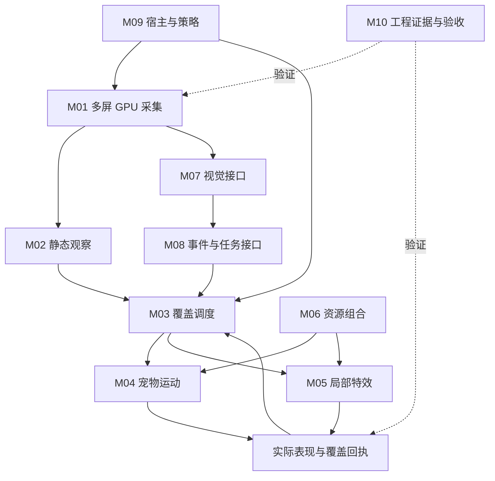

# 技术架构基线

日期：2026-10-25。类型：设计决策；所有实现、资源预算和兼容结论待隔离验证。需求依据见 PRODUCT，模块权威见 PLAN。

## 1. 部署与职责

首发 Windows，推荐 Godot .NET 表现主体 + 原生 Windows 感知组件。采集可采用同进程原生模块或隔离服务，决策由首个工程试验确定；两者共享同一帧/统计契约。若独立进程，使用有身份和访问控制的本地 IPC。GPU 资源共享须验证设备、适配器、格式和同步约束；不把原始指针/裸句柄当跨进程接口。

M01—M10 形成稳定模块；模块可以在一个程序或多个服务中实现。模块拆分不强制产生十个进程。具体技术可替换，数据所有权和接口语义保持稳定。

## 2. 多屏 GPU 帧采集

主后端 WGC：按显示器建立会话，获取带时间戳与尺寸的 D3D 帧。DXGI 为后续兼容/更新区域优化后端；第一版完成后端抽象与不可用降级，不以两套实际后端都实现作为首发必要条件。

每屏维护显示设备身份、拓扑代次、桌面物理坐标、像素尺寸、DPI 映射、旋转、色彩空间、SDR/HDR、显卡适配器身份、采集健康与缓冲预算。HMONITOR、输出序号、用户显示名都不单独作为跨重连的持久身份。

帧有获取/归还语义：消费者在租约内完成 GPU 运算或复制到自有有界纹理；归还后不引用其原表面。各屏分离背压，只保留最新可用帧和必要历史；慢视觉请求不得卡住静态检测或其他屏。

默认不保存/编码帧文件。目标是减少 GPU→CPU 读回与多次复制，是否零复制取决于采集、渲染、IPC 和推理框架的实际组合。跨显卡/进程退化路径计量复制开销；无法采集时报告原因，不能悄悄换成未经授权的抓取方式。

WGC 捕获标识/边框按系统支持与用户设置处理。若使用无边框能力，核实 API、权限和实际返回状态；持续捕获边框也可能成为固定亮区，必须进入验收。受保护内容、锁屏/安全桌面与拒绝捕获进入明确不可观测状态，不尝试绕过。

HDR 按后端能力协商合适格式，保留色彩元数据。静态比较在一致的色彩处理域进行；向普通视觉模型输送时按需色调映射。采集数值可作为亮度特征，不能无校准宣称面板实际 nits 或材料老化剂量。

## 3. 静态区域识别

感知路径为“GPU 帧 → 分块/多尺度特征 → 稳定时间图与可信度”。可在 GPU 做差分、边缘和亮度统计，仅向 CPU 返回有界网格统计；早期原型可读回局部/缩小帧，但必须记录性能与细线漏检风险。

初始试验建议 1—5 次/秒分析，作为参数探索范围而非已证明最优值。采集、分析、渲染与视觉分别限频；采样间隙中的变化无法完整观测，静态结论必须带采样跨度和可信度。

关键场景：

- 使用多尺度或稳定像素比例，避免闪烁光标使整块工具栏/线框重新计时。
- 细线和边缘不能只依靠整块平均颜色；视频局部动态不能掩盖周围固定 UI。
- 对无新帧、已知重复内容、超时、掉帧和设备丢失分别建模；只有有效健康观测才累计静态暴露。
- 更新/移动矩形是优化提示，合并矩形不证明全部像素变化；移动窗口与暴露新区域触发局部重新观察。
- 静态时间表示观察事实，不用于猜测用户是否在阅读。

底层静态观察与实际显示覆盖保持两本记录。优先验证排除本程序窗口的捕获方式；若捕获仍含宠物/魔法，使用已知遮罩把相关底层标为不可观测，保留先前状态而非清零或臆测持续不变。遮挡贡献由 M04/M05 输出的实际回执登记。

## 4. 覆盖调度

按屏维护静态暴露特征、最近访问、实际覆盖时间、调暗等效时间、内容动态替换时间和操作禁入区。大区低频公平访问与局部高价值区域选择结合，避免目标只聚集在少数亮区。

目标选择初始模型：静态程度、亮度特征、覆盖不足与用户偏好提高优先级；操作干扰、近期重复访问、资源成本降低优先级。权重可配置并有最小服务机会和打扰预算。选定合理候选后再随机选择动作、路线和效果，随机种子可记录以复现调度。

区分三种数据：

1. 访问：宠物经过的位置与时间。
2. 覆盖：实际可见图形替换原图像的面积、透明度和持续时间。
3. 调暗：相对底层的亮度降低估计及其适用条件。

黑色 alpha 遮罩可以在约定混合/色彩条件下记录 `alpha × 时间` 的调暗等效量；任意彩色/加色效果不能套用此公式。该量是显示调度统计，不是寿命或风险比例。宠物移动窗口的透明空白不计覆盖。

每个动作计划有目标屏/区域、预计形状与时长、优先级、取消原因和实际执行反馈。收到输入活动、显示器拓扑变更、禁入区改变或过期状态后立即仲裁取消/改道。通知不能无限抢占覆盖，覆盖也不能阻塞用户确认和操作。

## 5. 运动、动画与皮肤

M04 负责物理状态、路线、动作意图与桌面交互，输出角色姿态、动画语义与实际身体覆盖；M06 负责加载皮肤/动画/绑定并验证兼容。角色外观不决定全局覆盖策略，动画脚本不能直接驱动操作系统窗口。

动作分为位置运动（飞行、沿路径、跳跃、攀爬）与局部表现（摆动、眨眼、施法姿态），由一条动作仲裁链统一驱动。物理运动与路径运动切换必须有规则，避免两套控制器同时写坐标。

皮肤包提供外观、骨架或帧映射、命中形状与锚点；动作包提供时间线/姿态/帧选择和事件；绑定包将通用语义映射到具体皮肤能力。相同骨架可直接更换动画，跨骨架或精灵/Live2D 之间通过绑定或渲染适配器；不宣称任意资源天然互换。

## 6. 局部特效与窗口

M05 负责特效生命周期、渲染、实际覆盖描述和预算；基础目标是原生粒子、着色器、烟雾与不透明黑色/暗色遮罩。Effekseer 为可选运行适配器。

显示方案可为每屏透明无边框覆盖窗口，或局部窗口集合，先通过试验确定。即使覆盖窗口占满屏幕，画面仍保持局部效果；必须验证透明、鼠标穿透、焦点保护、特效不裁剪和真正纯黑五项能力。避免将纯黑透明色键当默认方案。

直接绘制的烟雾、幕布、黑洞不需要底层桌面纹理；对其他软件画面做扭曲/破碎则需要受控的底层纹理输入。引擎自身屏幕纹理不等于桌面帧。效果结束、异常、资源超限或暂停时有兜底撤除，不能留下阻挡工作的大块遮罩。

## 7. 视觉、API 和任务扩展

M07 从同一帧源按需选屏/窗口/ROI，裁剪、缩放、色彩转换后交给视觉适配器。请求携带触发、范围、帧时间、策略与超时；模型返回内容理解，不写静态事实或任务完成状态。保留文本/图像模型能力描述、服务地址、模型 ID 和密钥引用；真实密钥由宿主管理。

M08 接受版本化事件，规范化任务快照/增量、心跳和通知。接口覆盖本机 HTTP/IPC、未来 Webhook 或客户端适配；第一版实际完成一个本机认证入口与模拟任务源。普通任务事件可直接显示，模型摘要按需调用。多任务用 provider/project/session/task/run 身份隔离；来源失联显示 unknown/stale，不能当 success。

外部文本和视觉模型输出作为不可信输入：限长、转义、schema 校验与能力白名单。默认接口不提供任意 Shell、代码执行或由模型自动安装资源包的能力。

## 8. 数据、隐私与预算

程序配置只保存数据角色引用与模板。开发数据和日用数据分别位于根 README 登记的位置，模型、缓存与插件路径必须由集中配置提供。

默认帧在有界内存中使用后释放；持久化聚合覆盖统计是否开启由设置决定。调试画面采样、日志中的窗口标题和外部视觉上传分别由明确策略控制。采用 UIA 辅助时只读取所需结构/焦点，不默认收集全文。

首轮提出并验证的预算见 PLAN：每屏最大纹理数/尺寸、分析频率、总 GPU/CPU/RAM、视觉并发、效果粒子/区域/持续时长、通知队列、事件大小和日志保留。超限降低特效/采样或拒绝新请求，并保留原因。

## 9. 隔离工程与硬件验证

本项目 Hyper-V 控制定义拟位于 `tools/hyperv/control.ps1`，运行与凭据位于 `data/hyperv`；当前入口、客体和运行身份尚未建立。初始化工作包先登记项目客体/VM ID、run ID、nonce、源码与验证检查点、父盘代次/指纹/期限、输入范围/字节数/指纹、空间和时间资源预算，以及有界回执输出通道。

父盘消费前阅读共享供给当前 README/生命周期并核验；保持父盘不可变，只读输入进入客体，客体内私有副本执行。完成后释放输入，处置精确拥有的 VM、差分盘和可变配置，验证父盘未改；失败保留所有权、原因与复核日期。

虚拟显示器的通过只能证明对应虚拟环境。GPU API、HDR、多屏、驱动和透明覆盖的最终硬件覆盖需要登记的隔离客体具备相应能力；先调查受支持的 GPU/显示路径，不假定普通 Hyper-V 客体等同宿主物理显示器。如果客体无法覆盖，形成能力缺口和替代隔离验证方案，必要时在集中工程检查点解决；不能转为宿主开发试跑。

未来正式发布从干净本地 Git 检查点经已建立流程推进，确认客体输入释放和运行私有状态处置。正式发布标签、人类最终体验验收按独立授权执行。没有发布物或验收结果时不得写“已经上线”。
